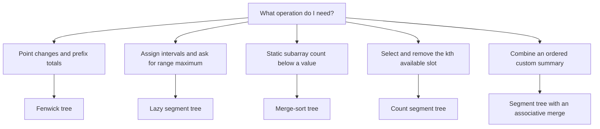

# Quick review

Use this as a recall sheet; the topic pages contain source links and implementations.

## Choosing a range structure

The operation and update model choose the structure. A problem carrying a “segment tree” tag is not evidence that the inspected solution used one.

| Recognition cue | Pattern and invariant | Trap |
| --- | --- | --- |
| Deletions make connectivity hard | [Reverse time + DSU](topics/dsu-and-graphs/README.md): replay deletions as insertions | Ordinary DSU cannot split a component |
| Connect an entire boundary | Virtual DSU nodes represent the top/bottom or another group | Component size includes virtual nodes |
| Cheapest global connection | Sort edges; Kruskal accepts only edges joining different roots | Report disconnected input; distinguish an MST from a forest |
| Must do prerequisites first | Kahn: queue contains exactly the currently zero-indegree vertices | Fewer processed vertices than `n` means a cycle |
| Several starting points | Multi-source BFS initializes all sources at distance zero | Mark visited on enqueue, not after repeated expansion |
| Repeated prefix totals | [Fenwick](topics/range-queries/README.md): each cell stores its lowbit block | Public zero-based index and internal one-based index are different |
| Assign a whole range | Lazy tag records an operation still owed to children | Zero can be a real assignment; it cannot also mean “no tag” |
| Kth available position | Segment sums count remaining slots | Decide whether `k` is zero- or one-based |
| Count values below a threshold in a subarray | Merge-sort tree: sorted values in each node | `lower_bound` counts `< x`; `upper_bound` counts `<= x` |
| Custom segment summary | Merge adjacent summaries in their original order | Associative does not imply commutative |
| Only the kth value matters | [Hoare quickselect](topics/search-and-sort/README.md): recurse into the target's partition | kth largest becomes ascending index `n-k`; worst case remains quadratic |
| Search smallest feasible capacity/time | Binary search on a monotone predicate | Prove monotonicity and bound the arithmetic |
| Count cross-half inequalities | Merge sort + monotone counting pointer | Count before overwriting halves; widen `2*x` |
| Nearest greater/smaller boundary | [Monotonic stack](topics/monotonic-and-heaps/README.md): dominated candidates never become useful | Equal values determine ownership and double counting |
| Sum a minimum/maximum's contribution | `(i-left)*(right-i)` choices own index `i` | Make one side strict and the other non-strict |
| Window candidates expire by index | Heap expiry or deque dominance, as appropriate to the source | A heap's stale entries may grow beyond window size |
| Negative values break a sum window | Prefix sums + a monotonic deque | “Shrink while too large” is not valid for arbitrary signs |
| Need both ends around the median | Ordered halves with a size/order invariant | Erase one indexed duplicate, not every equal value |
| O(1)-style recency updates | [LRU](topics/design-structures/README.md): map points to list nodes | Iterator ownership, capacity zero, and copied caches |
| Least frequent, then least recent | LFU frequency buckets with recency lists | Update `minFrequency` when the last item leaves a bucket |
| Repeated string mismatch | [KMP](topics/strings-and-tries/README.md): matched suffix is also a pattern prefix | Fallback through LPS; do not restart from zero every time |
| Prefix navigation | Trie transitions consume exactly one character | A prefix node is not necessarily a complete word |
| Prefix and suffix together | Encode suffix + separator + word | Separator must not occur in the supported alphabet |
| Nested syntax | Stack frames or recursive parsing | State belongs to the current nesting level |
| Local pointer rewrite | [List sentinel + saved next](topics/trees-and-lists/README.md) | Save links before overwriting them |
| Combine child results | Postorder subtree summary | Distinguish the best extendable path from the global best |
| Repeated subproblem | [Memoized DP](topics/dp-and-backtracking/README.md) | Empty/zero can be a computed answer; use a separate uncomputed state |
| Build candidates incrementally | Place, recurse, undo | Every mutation must be restored on all return paths |
| Distinct subsequences with repeats | Account for what the previous equal character already contributed | Normalize modular subtraction |
| Compatible weighted intervals | Binary-search the next compatible interval, then DP | Tie-breaking can require comparing the chosen paths |
| “At most K” or required multiplicities | [Frequency window](topics/windows-and-prefixes/README.md) | Track the quantity that changes validity, not just total length |
| Count subarrays with a target sum | Prefix frequency map | Insert prefix zero once; query before adding current prefix |
| Fixed minimum and maximum | Last invalid/min/max positions determine valid left endpoints | Clamp negative counts to zero |
| Maximize the number of compatible intervals | [Earliest-finish greedy](topics/greedy-and-intervals/README.md) | Whether touching endpoints overlap depends on interval semantics |
| Many identical greedy decrements | Frequency buckets batch equal values | Cost depends on the value range, not only `n` |
| Palindromes need only meet a minimum length | Check lengths `k` and `k+1` for an earliest finish | This relies on removing matching endpoints; state the proof |
| Repeated unordered triples | [Multiplicity counting](topics/math-and-bits/README.md) | Handle all-equal, two-equal, and distinct cases separately |
| Geometric nearest point on a rectangle | Clamp each coordinate independently | Squared-distance arithmetic can overflow |

## Six questions before writing code

1. What is the smallest state that proves the next move is safe?
2. What does one index mean, and are both endpoints included?
3. What happens for duplicates, zero, and the smallest valid input?
4. What invalidates a previously useful candidate?
5. Which operation dominates time and memory?
6. Can a brute-force version check small random inputs?
